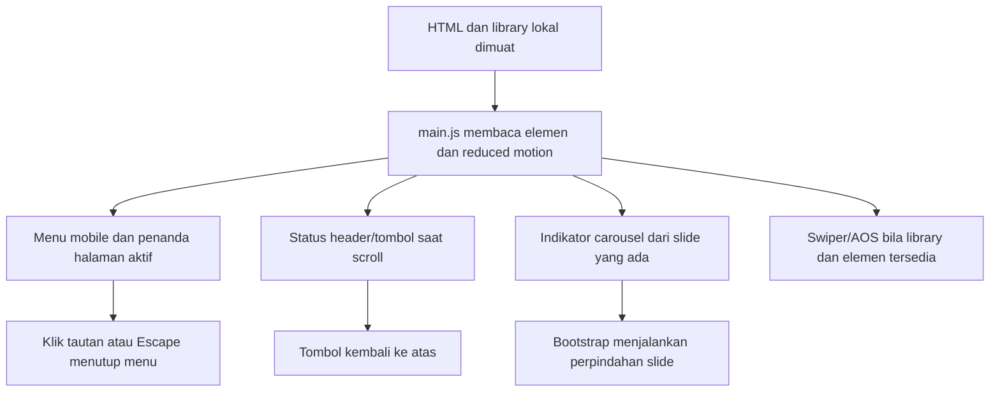

# Alur VAPEZOO statis

## Halaman dan data

Runtime terdiri dari tujuh berkas HTML beserta CSS, gambar dan library JavaScript lokal. Konten katalog/berita/FAQ berada langsung pada markup, tanpa fetch katalog, akun, keranjang atau backend.

| Berkas | Isi |
| --- | --- |
| [index.html](../index.html) | Beranda dan carousel |
| [about.html](../about.html) | Profil dari materi sumber |
| [produk.html](../produk.html) | Konten katalog sumber |
| [hexohm.html](../hexohm.html) | Informasi produk dari sumber |
| [news.html](../news.html) | Konten berita contoh |
| [faq.html](../faq.html) | Pertanyaan/jawaban dalam HTML |
| [kontak.html](../kontak.html) | Informasi kontak, peta dan form nonaktif |

Tautan halaman melakukan navigasi browser biasa; tidak ada router framework. Versi Laravel dan prototipe lain tetap aplikasi terpisah, sesuai [README](../README.md).

## Kontrol halaman

[assets/js/main.js](../assets/js/main.js) merupakan IIFE yang membaca elemen halaman dan hanya memasang fitur ketika elemennya tersedia.

setMenu mengubah kelas navbar-mobile, ikon dan aria-expanded/aria-label. Menu ditutup saat tautan dipilih, Escape ditekan, atau viewport memasuki desktop 992px. currentPage berasal dari nama berkas URL; root direktori dianggap index.html dan tautan aktif mendapat aria-current.

Handler scroll menyesuaikan tampilan header/topbar setelah 100px, kembali ke atas setelah 300px dan tautan kontak melayang setelah 1000px. Smooth scroll hanya dipasang untuk fragmen halaman yang benar-benar ada; hash kosong atau tujuan halaman lain tidak dipakai sebagai selector. Tinggi header diperhitungkan untuk tujuan gulir.

Indikator hero dibentuk sebagai tombol sesuai slide HTML. Carousel dan FAQ collapse memakai [Bootstrap lokal](../assets/vendor/bootstrap/js/bootstrap.bundle.min.js). main.js menginisialisasi slider testimonial/produk bila Swiper dan elemennya ada. AOS diaktifkan hanya bila tersedia. [particle-js/app.js](../assets/vendor/particle-js/app.js) memeriksa library, elemen particles-js dan reduced motion sebelum membuat partikel.

Reduced motion menghilangkan smooth scroll, menonaktifkan autoplay Swiper/AOS dan partikel, serta menghentikan carousel otomatis yang telah diinisialisasi Bootstrap. Konten bukan hasil animasi yang harus selesai agar data tersedia.

## Formulir dan layanan luar

Formulir newsletter dan kontak mempunyai fieldset disabled serta pemberitahuan bahwa penerima belum tersedia. Tidak ada penyimpanan data, pengiriman email, endpoint Express/Nodemailer atau checkout pada runtime ini. Menambahkan formulir aktif memerlukan backend dan kontrak baru; dokumen ini tidak menyatakan integrasi tersebut sudah ada.

Google Fonts, sematan Maps dan beberapa tautan kontak menggunakan layanan luar yang diwarisi sumber. Tidak ada kontak/pesan nyata yang dijalankan dalam pekerjaan dokumentasi ini. Materi sumber, termasuk isi FAQ, dijelaskan sebagai konten proyek, bukan hasil verifikasi operasional atau nasihat baru.

## Penyajian dan pemeriksaan

[Dockerfile](../Dockerfile) menyalin tujuh HTML dan assets/; [docker/nginx.conf](../docker/nginx.conf) menyajikan file statis serta menolak metode tulis dan berkas internal. Python pada [tests/serve.py](../tests/serve.py) hanya helper pengembangan. Node/npm juga hanya dipakai oleh tooling pengujian, bukan server aplikasi.

[tests/static.test.js](../tests/static.test.js) memeriksa referensi dan struktur sumber. [tests/browser.spec.js](../tests/browser.spec.js) mencakup halaman/aset/fragmen, menu, carousel, formulir nonaktif dan viewport sempit. Dokumen ini berasal dari pembacaan kode; tidak ada aplikasi/tes baru yang dijalankan dan tidak ada HTML/CSS/JavaScript/aset yang diubah.
